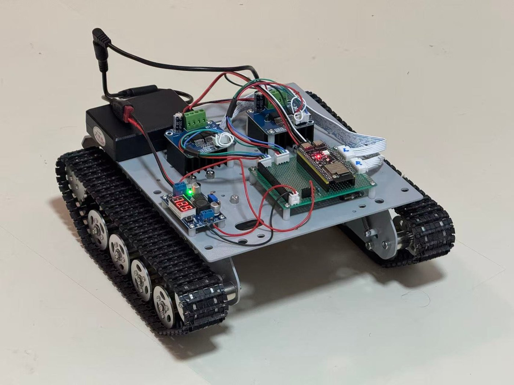
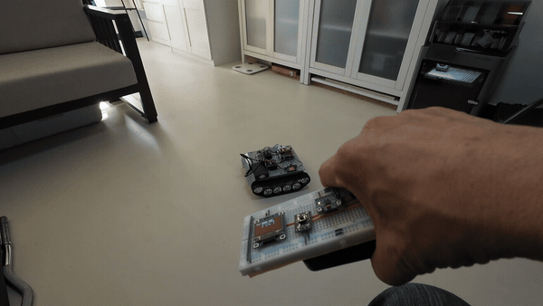

# r3car —— ESP32-S3 履带车



**手持板倾斜开车（没插遥控器时，板上的 MPU6050 接管）：**



一台自己焊、自己接线、自己写固件的履带车：**编码器闭环直行**，遥控器**不用电脑、不用路由器**，
直接无线怼过来。

## 现在能做什么

| 能力 | 说明 |
|---|---|
| 遥控 | DJI RC2 → 手持板 → **ESP-NOW** → 车（不经过 Mac，延迟 ~20 ms 量级） |
| 直行 | 左右轮各自追同一目标转速，差 0.3–0.8%，3 米偏约 1.5 cm |
| 上锁 | 遥控器左三态拨到**上位**，立刻断输出 |
| 安全 | 断链 200 ms 归零 / 2 s 退出遥控、低电限速、斜坡限速、解锁后油门必须先回中 |
| 遥测 | 电池电压（误差 0.1%）、左右轮转速、链路质量实时回传到手持端 |

## 硬件

| 件 | 型号 |
|---|---|
| 底盘 | 轮趣 R3 高配履带 183×178×50 mm |
| 电机 | MG540 ×2，12V 15W，1:30，330 rpm，霍尔编码器 13ppr |
| 驱动 | BTS7960 / IBT-2 ×2 |
| 主控 | ESP32-S3-N16R8 |
| 电池 | 3S 2550 mAh + 12.6V 充电器 |
| 降压 | 9–35V → 5V 5A |

## 软件

ESP-IDF v5.5.6，单文件 `main/main.c`：

- 主环 **100 Hz**，钉在 core 1
- 20 kHz MCPWM，占空比上限 98%
- 编码器 13 ppr × 30 减速 × 4 倍频 = **1560 计数/圈**
- 速度环：前馈 + PI（`KP 2.0`、`KI 3.0`、`MAX_RPM 330`）

## 三个版本都在仓库里

| 版本 | 在哪 | 是什么 |
|---|---|---|
| **ESP-NOW 版**（当前） | `main` 分支 / tag `now-v1` | 遥控器直连车，不经 Mac |
| WiFi 版 | tag `wifi-final`、分支 `wifi-version` | RC2 → Mac → WiFi(UDP 3333) → 车 |
| 台架版 | tag `car-v1` | 只有电机 + 编码器 + 串口命令 |

```bash
git checkout wifi-version     # 想回旧方案
git checkout main             # 回到现在这版
```

## 看什么

- **[项目状态.md](项目状态.md)** —— 完整交接文档：接线、参数、踩过的坑、下一步
- **[stage0-履带车-BOM与接线.md](stage0-履带车-BOM与接线.md)** —— 采购单和逐针接线
- **[logs/](logs/)** —— 实车日志，`capture.py` 是抓日志的脚本

## 配套工程

遥控那一半在 **[esp-now-joystick](https://github.com/zhangsino/esp-now-joystick)**：
DJI RC2 插在 ESP32-S3 的 USB 口上（板子当 USB Host 自己读），再通过 ESP-NOW 发出来，带一块小屏显示。
